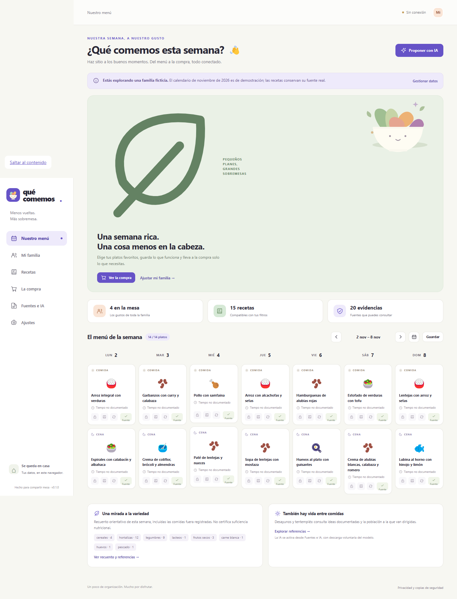
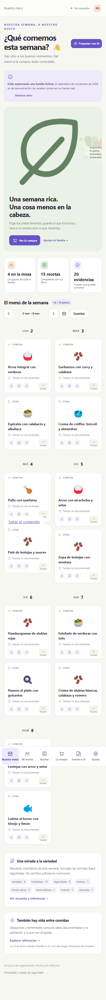

# 🥦 QuéComemos · 0.1.0

Una mesa organizada, una semana con menos decisiones. PWA familiar en español para consultar recetas documentadas, organizar menús y preparar la compra. Los datos y la inferencia se quedan en el navegador.

> Prototipo de pruebas. Las cantidades culinarias no son una prescripción nutricional. La app no certifica suficiencia nutricional ni ausencia de trazas.

## Pruébala

Sube el contenido de la aplicación a un alojamiento estático **HTTPS** y abre su dirección con Chrome o Edge. No necesita backend, cuentas, claves ni compilación. La instalación como aplicación es opcional.

En **Windows**, puedes probarla desde la carpeta descomprimida con el servidor local incluido, sin instalar Node ni Python:

```powershell
powershell -NoProfile -ExecutionPolicy Bypass -File .\scripts\Serve-QueComemos.ps1
```

Abre **http://127.0.0.1:8080**. La opción de ejecución se aplica solo a ese proceso. El servidor escucha únicamente en este equipo; detenlo con `Ctrl+C`. Puedes cambiar el puerto con `-Port 8081`.

**El doble clic en `index.html` (`file://`) no activa la PWA ni la IA.** Los Service Workers y WebGPU necesitan HTTPS o localhost. La primera carga y la descarga opcional del modelo requieren conexión. Después deben estar en caché todos los recursos necesarios.

## Un recorrido sencillo

1. Explora el catálogo o importa voluntariamente la demostración de **noviembre de 2026**: dos adultos y niños de 6 y 10 años, todos ficticios. El calendario contiene 30 fechas y 60 comidas/cenas; las recetas tienen procedencia documentada.
2. Configura tu familia, restricciones, tiempo y porciones manuales. Cambiar la edad no aplica factores de ración. Los valores son orientativos; una porción culinaria no equivale a una recomendación nutricional.
3. Prepara el modelo desde **Fuentes y RAG** si tu equipo es compatible. Solicita una semana o regenera un plato; puedes fijar las selecciones que quieras conservar.
4. Abre cada receta para consultar cantidades, pasos y fuentes. Revisa la lista de la compra, descuenta despensa y configura formatos de compra cuando los conozcas.
5. Exporta una copia JSON antes de borrar datos o cambiar de navegador.

La demostración guardada no se presenta como una generación de IA. Cuando no hay modelo compatible, siguen disponibles las recetas y los datos de demostración con el estado **«IA local no disponible»**.

## Capturas

Vistas reales de la aplicación en escritorio y móvil:

| Chrome | Edge |
| --- | --- |
|  |  |



## Importar fuentes y recetas

Selecciona una carpeta `DATOS_RAG` o varios archivos PDF con texto, TXT, Markdown y JSON. Las carpetas se leen solo tras tu selección. Los PDF escaneados necesitan OCR externo: la app no lo incluye.

Los documentos aportan contexto al índice BM25. Las recetas seleccionables deben existir en el catálogo o importarse como JSON estructurado con IDs, ingredientes, cantidades, raciones, pasos y procedencia. Los esquemas están en `schemas/` y el JSON de demostración es un ejemplo completo.

Las URL se descargan directamente desde el navegador. Si el servidor impide CORS, descarga el archivo y selecciónalo manualmente. No hay proxy ni servicio que reciba documentos.

## Qué hace el RAG

Extracción → fragmentos con metadatos → BM25 → recetas compatibles → fragmentos recuperados enviados al modelo local → respuesta estructurada → validación en JavaScript.

El modelo selecciona IDs existentes y referencias a fragmentos; no calcula cantidades ni crea recetas. La aplicación comprueba esas referencias y las restricciones, y muestra los fragmentos originales. Los documentos se tratan como datos, nunca como órdenes. La recuperación BM25 por sí sola no cuenta como generación de IA.

Si faltan candidatos o evidencia, aparece **«No hay información suficiente para completar este menú»**. Una alergia no se relaja automáticamente; la compatibilidad desconocida no se presenta como confirmada. Los registros de comidas fuera incompletos impiden afirmar que se cumplen frecuencias.

## Modelo y conexión

WebLLM **0.2.86**, PDF.js **6.4.299** y sus recursos de navegador se distribuyen localmente, con versiones y hashes en los manifiestos. Modelo inicial: **Qwen2.5-0.5B-Instruct-q4f16_1-MLC**, licencia Apache-2.0, revisión `32ff081fe7e4dfe4ffb167b94c66fdf11e02b8ad`.

Los pesos se descargan solo al pulsar el control de preparación. El tamaño exacto de los archivos y sus hashes se registra en el manifiesto del modelo. La memoria de GPU y los bytes de descarga son magnitudes diferentes; disponer de RAM suficiente no asegura compatibilidad WebGPU. Se necesita un adaptador compatible y aceleración gráfica en un navegador Chromium reciente.

La cancelación termina el Worker de carga/inferencia. La caché puede conservar archivos completos para un nuevo intento. El modo offline solo queda verificado cuando una sesión nueva arranca y genera realmente sin red; consulta los resultados y límites de prueba en [VALIDACION.md](VALIDACION.md).

**Limitación de esta versión:** las pruebas detectan WebGPU en la Intel UHD Graphics 770, pero la inferencia JSON real falla en el runtime probado. Por tanto, la generación RAG no se considera superada; utiliza el catálogo/menú manual y consulta [VALIDACION.md](VALIDACION.md) antes de confiar en la IA.

## Fuentes y licencias

El catálogo conserva cantidades originales y traduce al español las recetas seleccionadas de Canal Salut con atribución. No se incluyen imágenes ni marcas oficiales. Las cantidades «al gusto» o no especificadas no se convierten en gramos inventados.

AESAN aporta referencias generales, no la autoría de recetas. La guía escolar de la Generalitat y el recetario de Familia y Salud se enlazan para descarga, sin empaquetar sus PDF. Reutilización, fechas consultadas, créditos y adaptaciones se registran en [docs/FUENTES.md](docs/FUENTES.md). Los permisos específicos de una obra prevalecen sobre el aviso general del portal.

El código propio se distribuye bajo MIT; dependencias, modelo y contenidos documentados conservan sus licencias y condiciones, incluidas en sus carpetas y manifiestos.

## Privacidad y copias

Familia, menús, documentos e índice se guardan en **IndexedDB del navegador**. No hay analítica ni envío de perfiles a servicios de IA. La descarga del modelo y la importación por URL sí contactan con sus servidores de origen. La disponibilidad offline depende del almacenamiento que conserve el navegador.

Limpiar datos, usar modo privado o cambiar de origen/navegador puede perder la información local. Exporta copias JSON; contienen los datos familiares y documentos que hayas guardado, así que consérvalas como archivos privados. El borrado desde la app elimina sus datos y recursos descargados.

## Desarrollo y verificación

Solo el desarrollo necesita Node; el ZIP está listo para servir. Con Node LTS:

```text
npm ci
npm run prepare:vendor
npm test
npm run test:browser
npm run serve
```

Las pruebas de navegador usan los Chrome y Edge instalados en Windows. La validación generativa exige GPU real, descarga del modelo y pruebas adicionales; las pruebas con respuestas simuladas no la sustituyen. Resultados, capturas y casos pendientes se registran en `VALIDACION.md`.

## Versiones y entrega

Aplicación **0.1.0**; esquema y demostración **1.0.0**. Los entregables son `QueComemos-0.1.0.zip` y `QueComemos-DatosDemo-1.0.0.json`. La preparación de la entrega verifica la demostración y la copia descomprimida. Los commits siguen Conventional Commits.
